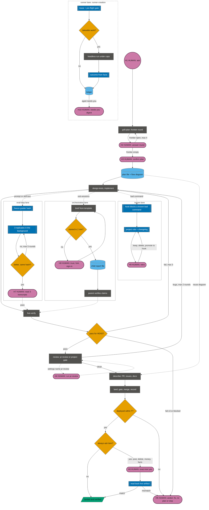

# the pipeline

A change moves through nine stages, 0 to 8, each run by one skill or by your agent's normal session. The `ship` skill works out which stage the branch is at from the evidence files on disk and hands off to the next one; each stage skill ends with a `next:` line naming the stage after it, and ends its report with `Checked:` / `Not checked:` lines so the next stage knows what it inherits. The line stops where evidence is missing: a plan that was never confirmed is shown as such at every stage, a verify report for an older commit counts as not verified, and nothing merges or publishes on a claim.

## stages

| # | Stage | Runs with | Writes | Agents it starts | Who starts it |
|---|---|---|---|---|---|
| 0 | explain | `walkthrough` | | | you or the agent |
| 1 | plan | `grill-plan` | `.claude/shipyard/plans/<branch>.md`: decisions, out of scope, acceptance checks, open questions, flow diagram, and an `## approval` section with `Approved: <date> plan-hash <hash>` once you confirm it (the hash covers the bytes above that heading) | fact lookups by subagent | you or the agent |
| 2 | test design | `design-tests` | | `test-designer` (in multi-agent runs) | you or the agent |
| 3 | implement | you and your agent in the normal session; `db-migration` when a database schema changes | | | you or the agent |
| 4 | verify live | `live-verify`; `eval-loop` too when the change is prompt or skill text | `.claude/shipyard/reports/live-verify-<branch>.md` with `Commit: <HEAD sha>` and `Result: pass\|fail\|blocked`; `eval-loop-<branch>.md` beside it | `live-verifier` (in multi-agent runs) | you or the agent |
| 5 | review | `pr-review`, or the project gate your settings name (run by `land`) | | `concern-reviewer`, `review-verifier` | you, `/shipyard-delivery:pr-review` (H4); or `land` for a gate |
| 6 | describe | `pr-description`, drawing with `flow-diagram` (reusing the plan's diagram) | the pull request | | you, `/shipyard-delivery:pr-description` |
| 7 | land | `land` | `.claude/shipyard/reports/land-<branch>.md` with `Verdict: landed \| gate failed \| not merged \| deploy did not run` | | you or the agent; the merge inside it waits for your yes unless its settings say `merge: auto` |
| 8 | demo | the skill your `ship` settings name; none in this pack | | | |

`<branch>` in a file name is the branch name with `/` replaced by `-`: `feat/x` writes `plans/feat-x.md` and `reports/live-verify-feat-x.md`.

Side skills, usable at any stage: `flow-diagram` draws for any written artifact (plans, PR descriptions, issues, docs; Mermaid for pages that render it, ASCII for terminals and editors) and reuses or updates the plan's diagram when it is the same flow; `eval-loop` runs grader rounds on a frozen grader set when the change is prompt, skill, or instruction text; `runner-creation` builds a scheduled headless runner, entering through `grill-plan` and handing off to verify live, then land; `build-workflow` runs the remaining stages as one multi-agent run; `skill-auditor` scores `SKILL.md` files; and in Claude Code the `signal` output style (answer first, one next step, progress markers), picked in Claude Code's settings.

Some stages need tools beyond the agent itself. `pr-review` reads pull requests and `pr-description` creates or updates them, and `land` merges, all through your code host's CLI or API, signed in. `live-verify` in browser mode needs a browser the agent can drive. Each skill says what it needs when it's missing.

## how ship places a branch

`ship` only routes; it never does a stage's work, and it is the authority on evidence: a stage skill's `next:` line is a suggestion, the files decide. It reads the project's `.claude/shipyard/ship.md` if there is one, then looks at the branch with cheap read-only checks: the current branch and HEAD, files changed against the merge base plus uncommitted ones, whether a pull request is open, the plan file, the stage reports, test files for the changed code, database schema files and their migrations. It runs no builds, no tests, and no agents; a test result is a claim from a commit message, you, or CI. Which files count as schema and migrations comes from `db-migration`: the `schema path` and `migrations path` in its settings file, `.claude/shipyard/db-migration.md` (or the older `prisma-workflow.md`), or else the schema and migration globs in its enabled adapters (only the Prisma adapter is enabled). `ship` reads those small files and runs no migration tool.

It walks the stage table top-down. The current stage is the last one with current evidence, or one left half-done; the next stage is the first whose evidence is missing and that isn't skipped. Code in the diff or an open pull request marks explain, plan, and test design done; nothing marks verify, review, or land done except their own reports. The evidence per stage:

| Stage | Done when | Otherwise |
|---|---|---|
| 1 plan | `plans/<branch>.md` exists; the `Approved:` line in its `## approval` section makes it `confirmed`; with a shell, `ship` recomputes the hash over the bytes above that heading and reports `edited since` on a mismatch | a goal with no plan file and no code goes to `grill-plan`, unless it is a one-file obvious change. A plan without the `Approved:` line is `unconfirmed`, and code with no plan is `Plan: none`; both appear on the report's `Plan:` line at every later stage, and neither blocks routing, since you chose to build |
| 4 verify live | `reports/live-verify-<branch>.md` says `Result: pass` and its `Commit:` is the current HEAD, or the settings skip verify (a library, docs only) | no report, a `fail` or `blocked`, or a report for an older commit (stale: the code moved after the check) all mean verify isn't done; `ship` names the gap (`report is for a1b2c3d, HEAD is e4f5a6b`) and routes to `live-verify`. A third `fail` in a row, or `blocked` after live-verify's own fix attempt, stops the line (H5): `ship` names the failing check and asks whether to fix, re-plan, or stop |
| 4 eval-loop | when the diff touches prompt, skill, or instruction text (the settings' `prompt paths`), `reports/eval-loop-<branch>.md` says `Result: pass` for HEAD; the settings can make it the verify evidence where there is no app to boot | `eval-loop` comes before verify counts as done |
| 5 review | the station the settings name (`review station: pr-review \| project gate` in `ship.md`, else in `land.md`): `pr-review`, which only you run (`ship` prints the command, H4), or `project gate`, which `land` runs, so review is deferred to stage 7 and describe comes next | with neither settings file the station is `pr-review` |
| 6 describe | an open pull request that describes HEAD, or the settings' `describe` report path | `pr-description` |
| 7 land | `reports/land-<branch>.md` says `Verdict: landed` | any other verdict means land isn't done: `deploy did not run` is a stopped line (H5), which `ship` reports with the command the report hands over and routes no further; `gate failed` and `not merged` go back to implement with the report's reason |
| 8 demo | the settings name a demo skill | `ship` names demo as the last stage and stops |

A changed schema with no new migration means implement isn't done, so it routes to `db-migration` before verify. The report has five lines, `Stage:`, `Plan:`, `Skipped:`, `next:`, and `Then:`, and it stops to ask before starting the next stage. [examples/ship-transcript.md](../examples/ship-transcript.md) shows one run.

On a yes, it starts the next skill itself when the agent may start it (walkthrough, grill-plan, design-tests, db-migration, live-verify, eval-loop, flow-diagram, land). `land` takes the repo's land lock (`.git/shipyard-land.lock`) and merges only when its settings say `merge: auto` or you say yes to the merge inside it. For `pr-review`, `pr-description`, and `build-workflow` it prints the exact command for you to run, because those skills set `disable-model-invocation` and Claude Code blocks the agent from starting them. Agents that ignore that field may start them unasked, which is why the [AGENTS.md snippet](agents-install.md#3-paste-the-agentsmd-snippet) says not to. Implement belongs to your session: `ship` tells you to continue here.

Arguments: a stage (number, name, or skill name) jumps to it, asking first if its entry condition isn't met; jumping to review never skips the verify gate silently. `all` prints a `/shipyard-delivery:build-workflow <plan file> <remaining stages>` command, which runs the remaining stages as one multi-agent run; it shows its own run plan and waits for a go.

## where a person is needed

The names below are used in the skills' text, so a stop reads the same everywhere.

| Point | Where | What you see | If you don't answer |
|---|---|---|---|
| H1 ask | intake | nothing yet; the first grill round follows | no work starts |
| H2 answer a round | `grill-plan` | numbered questions, each with a recommended answer first, so "yes" accepts it | the round stays open; after the round cap, "proceed open or one more round" |
| H3 confirm plan | end of `grill-plan` | the plan file | the plan is marked `unconfirmed`; `ship` shows that at every stage; no build unless you say "just build it" |
| H4 run pr-review | review, when the settings name `pr-review` | the exact command | `land` runs the project gate instead where the settings say so; otherwise the branch waits at review |
| H5 andon | verify failed 3 times or blocked, `deploy did not run`, read-back mismatch | the failing check or missing item, the report, and the one command or fact needed | the line stays stopped; nothing merges or publishes |
| H6 exact-text yes | the always-ask list: public posts, deletes, money, facts about you | the exact text or object, what is lost (for deletes), the version the yes applies to | nothing is sent, deleted, paid, or asserted |
| H7 read 3 eval transcripts | `eval-loop` pass | 3 raw transcripts plus the pass table | not passed |
| H8 batched user-only steps | multi-agent and side-session runs | one list with the exact page or command (trust, fork, sign-in) | the child reports blocked; the parent waits on that list only |
| H9 retro | kaizen, on a cadence | each rule with its fire count | rules are kept |
| H10 needs-you digest | a runner from `runner-creation` | one aged list with first-seen and escalation | items stay quarantined |

A skill that merges, publishes, or deletes asks before the irreversible step unless the project's settings grant it (`land`: `merge: auto`). The always-ask list is never automatic.

## caps

Defaults; every project's settings file can change them.

| Cap | Default | Where |
|---|---|---|
| grill rounds | 4, then the plan is written with open questions marked | `grill-plan` |
| fact lookup | 5 min, then the fact is marked unknown and the question held | `grill-plan` |
| verify fix loop | 3 fails, then andon (H5) | `ship`, `live-verify` |
| review fix rounds | 2, then you decide | `pr-review`, `land` |
| eval fix rounds | 5, then the trend is reported | `eval-loop` |
| deploy wait T | 10 min, then `deploy did not run` | `land` |
| re-sync after the base moved | 2, then stop and report | `land` |
| lands per repo | 1 at a time (lock file `.git/shipyard-land.lock`) | `land` |
| child start check | 2 min, then the user-only step is batched (H8) | `build-workflow` |

## the factory on one page

The main line runs top to bottom; the lanes on the right run beside it. Reddish-purple stadiums are the human points above, orange diamonds are gates, blue boxes are scripts and hooks, slate boxes are agent stations, cylinders are files on disk.



## handoffs

Every stage skill ends with a `next:` line and closes its report with `Checked:` / `Not checked:` lines; `ship` reads the report, not the `next:` line, to decide.

| Skill | `next:` |
|---|---|
| `grill-plan` | the test design stage, through `design-tests` with the plan file; a one-file change skips to implement |
| `design-tests` | the implement stage, or whoever writes the tests |
| `db-migration` | back to implement, with the migration name and the final status output from the migration tool |
| `live-verify` | a pass goes to review; a fail goes back to implement with the report |
| `eval-loop` | a pass goes to verify live when the change also touches running code, else to review; `stopped` or a holdout match goes back to you with the trend |
| `pr-review` | fixes go back to implement; a clean review goes to describe |
| `pr-description` | land, with the pull request's link; its human reviewers read it meanwhile |
| `land` | the pull request's human reviewers when not merged; after a landed merge, demo when the settings name one, else done; `deploy did not run` is an andon (H5) |
| `runner-creation` | verify live (the headless dry run and forced-failure checks against the real agent CLI), then land for the wrapper and the schedule |
| `build-workflow` | a clean run goes to describe if it didn't run; a blocked or halted run goes back to you with the blocker |
| `ship` | the stage you confirm, through its own skill |

`walkthrough`, `flow-diagram`, and `skill-auditor` have no stage after them. The exact wording of each handoff is on its page under [skills/](skills/README.md).

## how pr-review works

`pr-review` slices the diff, has one agent per slice map the review concerns to the added lines and review each one, drops any finding whose quoted line isn't in the diff, and has a separate agent validate what's left. Every agent runs on the model of the session that started the skill, and nothing edits files or commits.

```
scope.sh ──> full.diff + diff.txt ("path:line: code", added lines only)
   │         slices: one if ≤ 10 files and ≤ 400 added lines; else ~400 lines each,
   ▼         by top-level directory, security paths alone, at most 6 (slices grow past it)
1 Map and review   concern-reviewer per slice, in parallel, whole catalog each:
   │               MAP concerns to its lines, then REVIEW each: finding or cleared
   ▼
check (no model)   drop findings whose evidence_line isn't at location; flag unreviewed ids
   ▼
2 Validate         review-verifier, one agent over every slice's findings:
   │               confirmed | false-positive | pre-existing | duplicate
   ▼
report from confirmed findings only: Bugs / Issues / Nits / Summary + coverage
```

The catalog is the list of concerns a reviewer checks: the starter files in the skill's `references/catalog-*.md` plus the project's own `.claude/shipyard/pr-review/concerns.md`, which wins when ids collide. `/shipyard-delivery:pr-review mine` builds or refreshes that project file from past review comments.

Scope: `scope.sh` writes `full.diff` (the unified diff against the base, limited to the review paths) and `diff.txt` (added lines only, one per line as `path:line: code`). With no added lines it reports "No changes to review." and stops.

Slices are computed without a model. A change of at most 10 files and 400 added lines is one slice. A bigger one is grouped by top-level directory and packed into slices of about 400 added lines; files under security-sensitive paths (default: paths containing `auth`, `permission`, `payment`, `secret`, `tenant`, `tenancy`) get slices of their own; a file is never split. Past the agent cap (default 6), slices grow by a quarter at a time until the plan fits. Slice size, the cap, and the security paths can be set in the project's settings.

Map and review: each `concern-reviewer` gets the whole catalog and its slice's added lines, and can read the whole repository. It first writes out every concern that has a site in its slice, each site as a `path:line` copied from `diff.txt`, then reviews each one against the real code (callers, callees, tests). A concern ends as a finding with a concrete failure scenario, or cleared with a reason.

Check: a script, no model. A finding whose `location` isn't an added line, or whose quoted `evidence_line` isn't the code at that line, is dropped and counted. A mapped concern with neither a finding nor a clearance is counted and listed as unreviewed, never hidden.

Validate: one `review-verifier` sees every surviving finding from every slice at once, without the reviewers' reasoning. It tags each one confirmed, false-positive, pre-existing (the base already had it), or duplicate, may lower its severity, and writes a one-line ship verdict.

Report: compiled by the script from confirmed findings only, bugs first, cut at the findings cap (default 10) with the cut stated. Bugs, Issues, and Nits each say `none` when empty. The summary line gives the counts, the advisory verdict, and a coverage line: slices, concerns read, concerns mapped, findings dropped, confirmed, rejected, unreviewed. A count nothing produced prints as `n/a`, never an estimate.

With a workflow runner (Claude Code's Workflow tool), the skill runs `references/workflow.js`. Without one, the session starts the agents itself; without any subagent support, it runs the stages inline, one slice at a time, and says so in the report's `Pipeline:` line. Contracts, schemas, and the report template are in [stages.md](../plugins/shipyard-delivery/skills/pr-review/references/stages.md).
